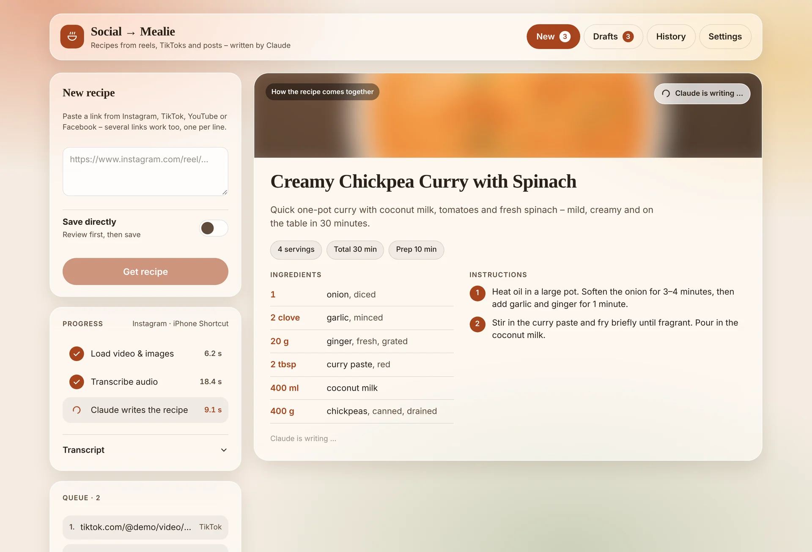
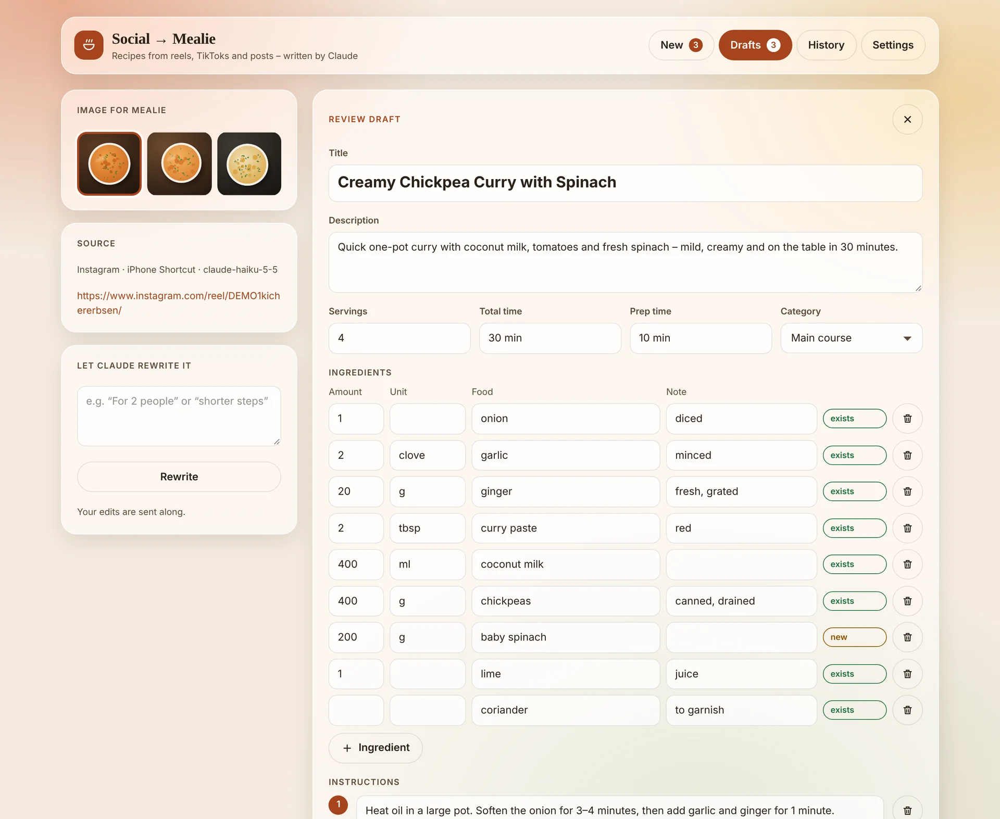
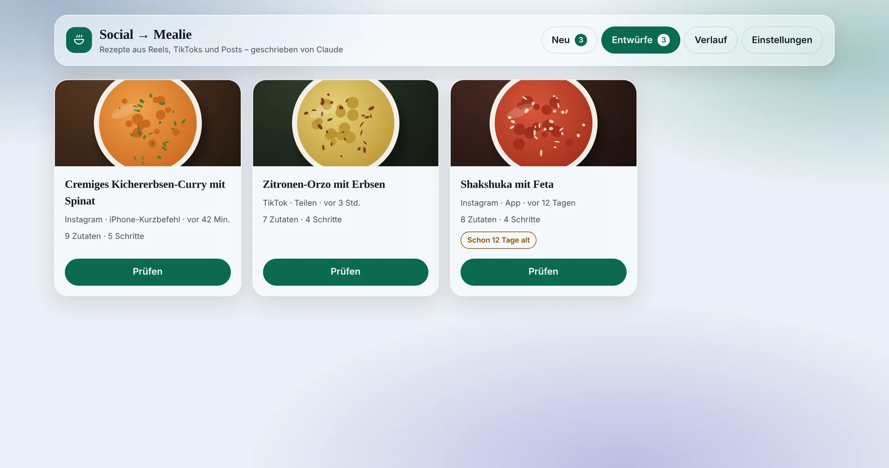
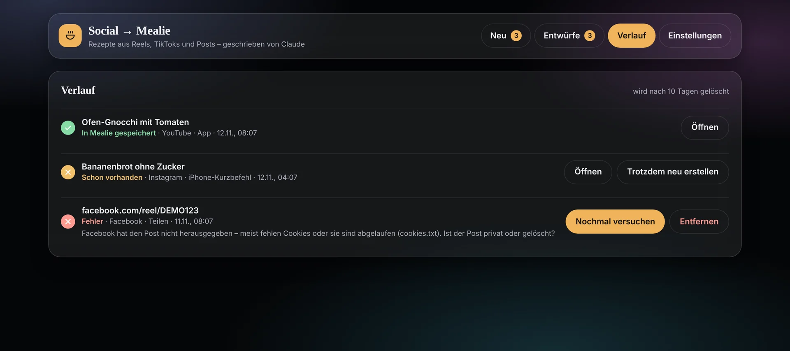
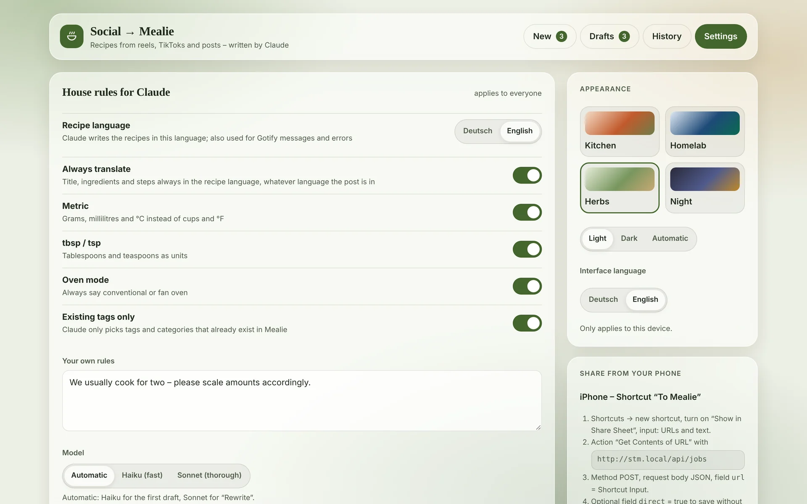
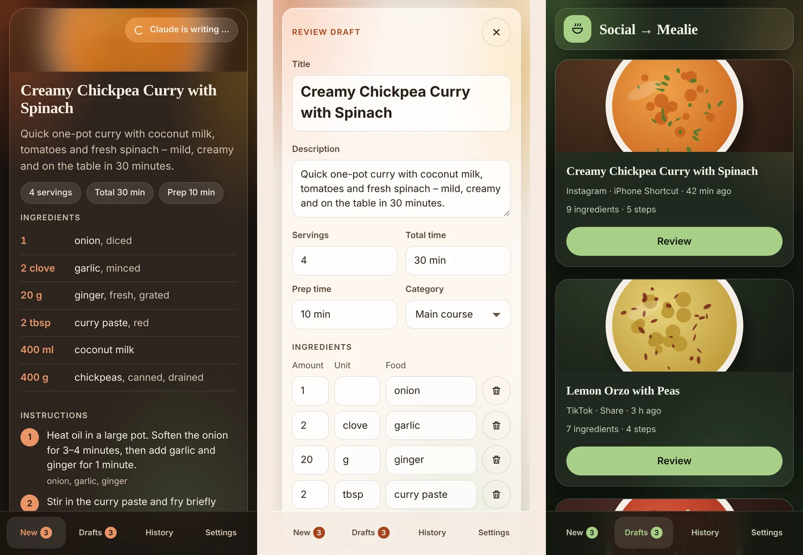

[English](README.md) · **Deutsch**

<p align="center">
  
</p>

<h1 align="center">Social → Mealie</h1>

<p align="center">
  Macht aus Rezept-Reels, TikToks und Posts saubere <a href="https://github.com/mealie-recipes/mealie">Mealie</a>-Rezepte – geschrieben von Claude, geprüft von dir.
</p>

> [!NOTE]
> Das ist ein Fork von [GerardPolloRebozado/social-to-mealie](https://github.com/GerardPolloRebozado/social-to-mealie).
> Statt OpenAI schreibt hier **Claude (Anthropic-API)** die Rezepte, jeder Link läuft als **Hintergrund-Job**, und die Oberfläche ist komplett neu.
> Image: `ghcr.io/twix99b/social-to-mealie:latest`



## Was die App macht

Link einfügen oder vom Handy teilen. Die App lädt Video und Bilder, transkribiert den Ton lokal mit Whisper und lässt Claude ein strukturiertes Rezept schreiben – Titel, Zutaten und Schritte erscheinen live. Danach prüfst du den Entwurf und speicherst ihn mit einem Tipp in Mealie.

- **Live-Ansicht „So entsteht das Rezept“** – Ablauf mit Zeiten, aufklappbares Transkript, das Rezept erscheint, während Claude schreibt
- **Hintergrund-Jobs mit Warteschlange** – Seite schließen, der Job läuft weiter; [Gotify](https://gotify.net) meldet „bereit zum Prüfen“ und Fehler
- **Erst prüfen, dann speichern** – alles ist bearbeitbar, Titelbild aus den Bildern des Posts wählen oder Claude mit einem Hinweis neu schreiben lassen (mit dem größeren Modell)
- **Passt zu deinem Mealie** – Zutaten getrennt nach Menge / Einheit / Lebensmittel / Notiz und mit vorhandenen Lebensmitteln und Einheiten abgeglichen; Tags und Kategorien nur aus den vorhandenen
- **Duplikat-Prüfung** – ein Link, der schon in Mealie ist, wird erkannt, bevor Claude gefragt wird (kostet nichts)
- **Hausregeln** – Deutsch, metrisch, EL/TL, Ofenart, eigene Hinweise und Modellwahl, auf dem Server gespeichert und für alle gleich
- **Teilen vom Handy** – iPhone-Kurzbefehl über die API, Android über die installierbare Web-App (Teilen-Menü)
- **Vier Themen** (Küche, Homelab, Kräuter, Nacht), jeweils Hell / Dunkel / Automatisch, pro Gerät gespeichert
- Der Verlauf bleibt 10 Tage, Entwürfe bleiben, bis du sie erledigst

## Screenshots

| Entwurf prüfen | Entwürfe |
| --- | --- |
|  |  |
| **Verlauf** | **Einstellungen** |
|  |  |

<p align="center"></p>

<sub>Die Screenshots zeigen Beispieldaten.</sub>

## So funktioniert es

```
Link ─► Duplikat-Prüfung (Mealie orgURL) ─► Download mit yt-dlp + Bilder ─► Whisper (lokal) ─► Claude (gestreamt)
     ─► Lebensmittel / Einheiten abgleichen ─► Entwurf ─► Prüfen ─► Mealie (Rezept, strukturierte Zutaten, Bild)
```

Jobs, Entwürfe, Einstellungen und Bilder liegen in einer JSON-Datei in `/app/data` (als Volume einbinden). Jobs, die ein Neustart unterbrochen hat, landen wieder in der Warteschlange.

## Voraussetzungen

- [Mealie](https://github.com/mealie-recipes/mealie) ab v2 und ein API-Token (Profil → API-Tokens). Ein KI-Anbieter in Mealie selbst ist **nicht** nötig.
- Ein [Anthropic-API-Key](https://console.anthropic.com/)
- Docker

## Schnellstart

```yaml
services:
  social-to-mealie:
    image: ghcr.io/twix99b/social-to-mealie:latest
    container_name: social-to-mealie
    restart: unless-stopped
    ports:
      - "4000:3000"
    volumes:
      - ./data:/app/data                 # Jobs, Entwürfe, Einstellungen, Bilder, Whisper-Modell
      - ./cookies.txt:/app/cookies.txt   # optional, für Instagram / Facebook
    environment:
      - ANTHROPIC_API_KEY=${ANTHROPIC_API_KEY}
      - LOCAL_TRANSCRIPTION_MODEL=Xenova/whisper-small
      - MEALIE_URL=http://mealie:9000
      - EXTERNAL_MEALIE_URL=https://mealie.example.com
      - MEALIE_API_KEY=${MEALIE_API_KEY}
      - GOTIFY_URL=https://gotify.example.com      # optional
      - GOTIFY_TOKEN=${GOTIFY_TOKEN}               # optional
      - APP_URL=https://social-to-mealie.example.com
    security_opt:
      - no-new-privileges:true
```

Der Container läuft als Benutzer `1001`, der Datenordner muss für ihn beschreibbar sein:

```sh
mkdir -p data && sudo chown -R 1001:1001 data
touch cookies.txt && sudo chown 1001:1001 cookies.txt
docker compose up -d
```

Der erste Link mit Ton dauert ein paar Minuten länger, weil das Whisper-Modell (bei `whisper-small` etwa 250 MB) einmal nach `data/models` geladen wird.

## Umgebungsvariablen

| Variable | Pflicht | Standard | Beschreibung |
| --- | --- | --- | --- |
| `ANTHROPIC_API_KEY` | ja | – | Anthropic-API-Key; Claude schreibt die Rezepte |
| `MEALIE_URL` | ja | – | Adresse, unter der der Container Mealie erreicht |
| `MEALIE_API_KEY` | ja | – | Mealie-API-Token (ohne Anführungszeichen) |
| `EXTERNAL_MEALIE_URL` | nein | `MEALIE_URL` | Mealie-Adresse für die Links „In Mealie öffnen“ |
| `MEALIE_GROUP_NAME` | nein | `home` | Mealie-Gruppe, wird in Rezept-Links verwendet |
| `LOCAL_TRANSCRIPTION_MODEL` | empfohlen | – | Whisper-Modell (ONNX) von Hugging Face, z. B. `Xenova/whisper-small` oder `Xenova/whisper-base` |
| `CLAUDE_MODEL_FAST` | nein | `claude-haiku-5-5` | Modell für den ersten Entwurf (Einstellung „Automatisch“ / „Haiku“) |
| `CLAUDE_MODEL_SMART` | nein | `claude-sonnet-5-5` | Modell für „Neu schreiben“ (Einstellung „Automatisch“ / „Sonnet“) |
| `ANTHROPIC_URL` | nein | `https://api.anthropic.com` | Anderer Endpunkt / Proxy |
| `GOTIFY_URL`, `GOTIFY_TOKEN` | nein | – | Push-Meldungen für „bereit zum Prüfen“, gespeichert und Fehler |
| `APP_URL` | nein | – | Öffentliche Adresse dieser App; Meldungen verlinken direkt auf den Entwurf |
| `DATA_DIR` | nein | `/app/data` | Speicherort für Jobs, Bilder und Modell-Cache |
| `RETENTION_DAYS` | nein | `10` | So lange bleiben Einträge im Verlauf |
| `COOKIES` | nein | – | Cookie-String für yt-dlp (`NAME=WERT`); alternativ `cookies.txt` einbinden |
| `YTDLP_VERSION` | nein | `latest` | yt-dlp-Version, die beim Start installiert wird |

> [!WARNING]
> `TEXT_MODEL` aus dem Originalprojekt wird weiterhin als Ersatz für `CLAUDE_MODEL_FAST` gelesen. Steht dort noch ein OpenAI-Modell, die Variable entfernen.

## Vom Handy teilen

**iPhone – Kurzbefehl „An Mealie“**

1. Neuen Kurzbefehl anlegen, „Im Share-Sheet anzeigen“ einschalten, Eingabe: URLs und Text.
2. Aktion „Inhalte von URL abrufen“: `https://<deine-app>/api/jobs`
3. Methode `POST`, Anfragetext `JSON`, Feld `url` (Text) = Kurzbefehleingabe.
4. Optional: Feld `direct` (Boolesch) = Ja, um ohne Prüfen zu speichern.
5. Optional: „Mitteilung anzeigen“ mit „Läuft – Gotify meldet sich“.

**Android** – App in Chrome öffnen → Menü → „App installieren“. Danach steht „Social → Mealie“ im Teilen-Menü.

## API

| Methode | Pfad | Zweck |
| --- | --- | --- |
| `POST` | `/api/jobs` | Neue Jobs. JSON `{ "url": "…" }`, `{ "urls": [] }` oder `{ "text": "…" }` (alle Links im Text werden genommen), optional `"direct": true`. Reiner Text als Anfrage geht auch. |
| `GET` | `/api/jobs` | Alle Jobs |
| `GET` | `/api/jobs/:id` | Ein Job |
| `DELETE` | `/api/jobs/:id` | Entwurf oder Verlaufseintrag verwerfen |
| `POST` | `/api/jobs/:id/save` | In Mealie speichern, Body `{ recipe?, imageIndex? }` |
| `POST` | `/api/jobs/:id/rewrite` | Von Claude neu schreiben lassen, Body `{ hint?, recipe? }` |
| `POST` | `/api/jobs/:id/retry` / `force` | Nochmal versuchen / trotz Duplikat neu erstellen |
| `GET` | `/api/events` | Server-Sent Events (Stand, Job-Änderungen, Live-Rezept) |
| `GET`/`PUT` | `/api/settings` | Hausregeln und Modellwahl |

Der alte Endpunkt `/api/get-url` gibt es für bestehende Kurzbefehle weiterhin.

> [!IMPORTANT]
> Die App hat keine Anmeldung. Wer sie erreicht, kann Rezepte in deinem Mealie anlegen und dein Anthropic-Guthaben verbrauchen. Betreibe sie im Heimnetz oder hinter einem Reverse Proxy mit Zugriffsschutz (VPN, IP-Freigabeliste, SSO).

## Unterstützte Plattformen

Getestet sind Instagram, TikTok, YouTube (Shorts), Facebook und Pinterest. Alles, was [yt-dlp](https://github.com/yt-dlp/yt-dlp) laden kann, sollte funktionieren. Instagram und Facebook brauchen oft Cookies (`cookies.txt`). Streikt eine Plattform, den Container neu erstellen, damit das aktuelle yt-dlp installiert wird.

## Entwicklung

```sh
pnpm install
cp example.env .env   # eigene Werte eintragen
pnpm dev
```

Pushes auf `main` bauen `:latest`, Pushes auf den Zweig `redesign` bauen `:dev`.

## Dank & Lizenz

Basiert auf [social-to-mealie](https://github.com/GerardPolloRebozado/social-to-mealie) von GerardPolloRebozado. Lizenz: [GPL-3.0](LICENSE).
