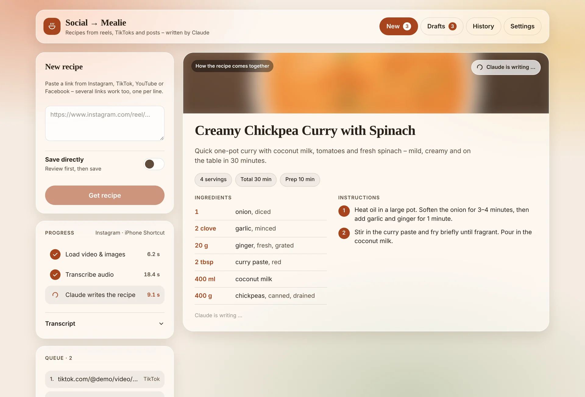
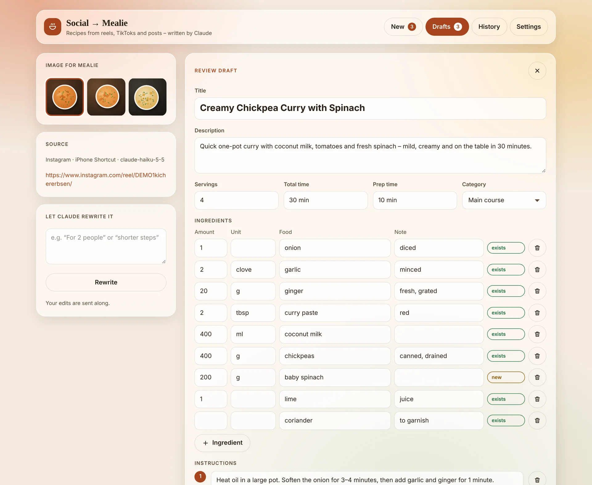
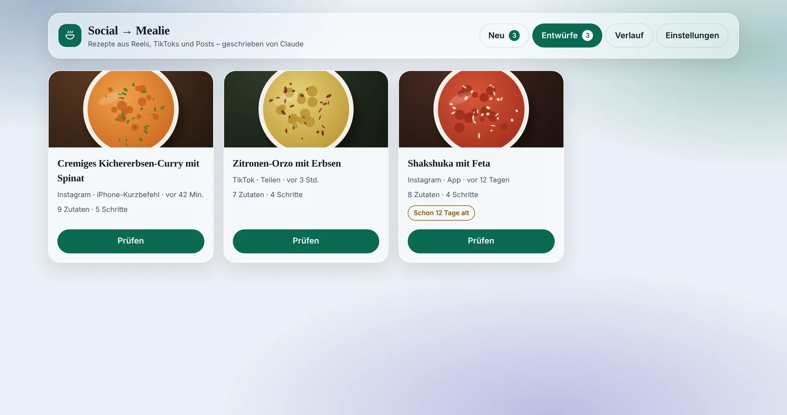
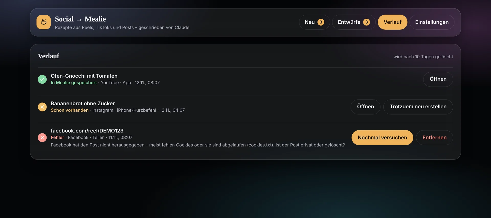
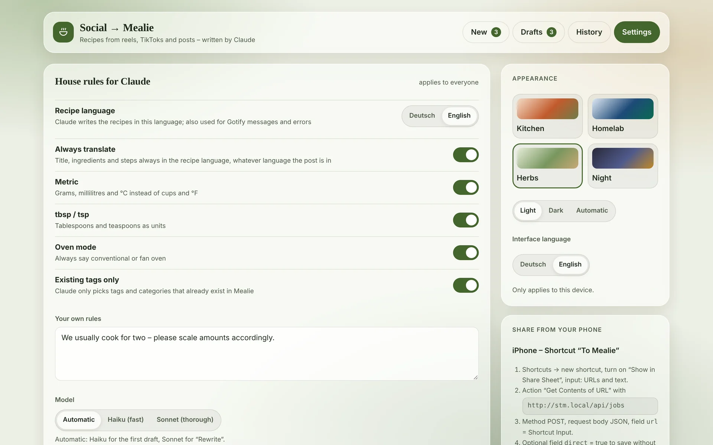
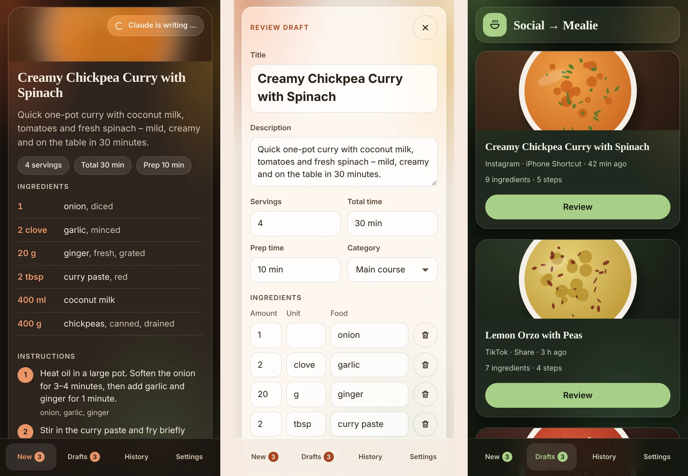

**English** · [Deutsch](README.de.md)

<p align="center">
  
</p>

<h1 align="center">Social → Mealie</h1>

<p align="center">
  Turn recipe reels, TikToks and posts into clean <a href="https://github.com/mealie-recipes/mealie">Mealie</a> recipes – written by Claude, reviewed by you.
</p>

> [!NOTE]
> This is a fork of [GerardPolloRebozado/social-to-mealie](https://github.com/GerardPolloRebozado/social-to-mealie).
> It replaces the OpenAI flow with **Claude (Anthropic API)**, runs every link as a **background job** and comes with a completely new interface.
> Image: `ghcr.io/twix99b/social-to-mealie:latest`



## What it does

Paste a link (or share it from your phone). The app downloads the video and images, transcribes the audio locally with Whisper and lets Claude write a structured recipe – you watch title, ingredients and steps appear live. Then you review the draft and save it to Mealie with one tap.

- **Live view "So entsteht das Rezept"** – step list with timings, collapsible transcript, the recipe streams in while Claude writes
- **Background jobs with a queue** – close the page, the job keeps running; [Gotify](https://gotify.net) tells you when a draft is ready or something failed
- **Review before saving** – everything is editable, pick the cover image from the post, or let Claude rewrite it with a hint (uses the bigger model)
- **Fits your Mealie** – ingredients are split into quantity / unit / food / note and matched against your existing foods and units; tags and categories are only picked from the ones you already have
- **Duplicate check** – a link that is already in Mealie is recognised before Claude is asked (no cost)
- **House rules** – German, metric, EL/TL, oven type, plus your own free-text rules and model choice, stored on the server for everyone
- **Share from the phone** – iOS Shortcut via the API, Android via the PWA share target
- **Four themes** (Küche, Homelab, Kräuter, Nacht), each light / dark / auto, saved per device
- History is kept for 10 days, drafts stay until you handle them

The interface is in German.

## Screenshots

| Review a draft | Drafts |
| --- | --- |
|  |  |
| **History** | **Settings** |
|  |  |

<p align="center"></p>

<sub>Screenshots use demo data.</sub>

## How it works

```
link ─► duplicate check (Mealie orgURL) ─► yt-dlp download + images ─► Whisper (local) ─► Claude (streamed tool call)
     ─► match foods / units ─► draft ─► review ─► Mealie (recipe, structured ingredients, image)
```

Jobs, drafts, settings and images live in one JSON store in `/app/data` (mount it as a volume). Jobs that were interrupted by a restart go back into the queue.

## Requirements

- [Mealie](https://github.com/mealie-recipes/mealie) v2 or newer and an API token (Profile → API Tokens). Mealie's own AI provider is **not** needed.
- An [Anthropic API key](https://console.anthropic.com/)
- Docker

## Quick start

```yaml
services:
  social-to-mealie:
    image: ghcr.io/twix99b/social-to-mealie:latest
    container_name: social-to-mealie
    restart: unless-stopped
    ports:
      - "4000:3000"
    volumes:
      - ./data:/app/data                 # jobs, drafts, settings, images, Whisper model
      - ./cookies.txt:/app/cookies.txt   # optional, for Instagram / Facebook
    environment:
      - ANTHROPIC_API_KEY=${ANTHROPIC_API_KEY}
      - LOCAL_TRANSCRIPTION_MODEL=Xenova/whisper-small
      - MEALIE_URL=http://mealie:9000
      - EXTERNAL_MEALIE_URL=https://mealie.example.com
      - MEALIE_API_KEY=${MEALIE_API_KEY}
      - GOTIFY_URL=https://gotify.example.com      # optional
      - GOTIFY_TOKEN=${GOTIFY_TOKEN}               # optional
      - APP_URL=https://social-to-mealie.example.com
    security_opt:
      - no-new-privileges:true
```

The container runs as user `1001`, so the data folder must be writable for it:

```sh
mkdir -p data && sudo chown -R 1001:1001 data
touch cookies.txt && sudo chown 1001:1001 cookies.txt
docker compose up -d
```

The first link with audio takes a few minutes longer, because the Whisper model (about 250 MB for `whisper-small`) is downloaded once into `data/models`.

## Environment variables

| Variable | Required | Default | Description |
| --- | --- | --- | --- |
| `ANTHROPIC_API_KEY` | yes | – | Anthropic API key; Claude writes the recipes |
| `MEALIE_URL` | yes | – | URL the container uses to reach Mealie |
| `MEALIE_API_KEY` | yes | – | Mealie API token (without quotes) |
| `EXTERNAL_MEALIE_URL` | no | `MEALIE_URL` | Mealie URL used for "open in Mealie" links |
| `MEALIE_GROUP_NAME` | no | `home` | Mealie group, used in recipe links |
| `LOCAL_TRANSCRIPTION_MODEL` | recommended | – | Hugging Face ONNX Whisper model, e.g. `Xenova/whisper-small` or `Xenova/whisper-base` |
| `CLAUDE_MODEL_FAST` | no | `claude-haiku-5-5` | Model for the first draft (setting "Automatisch" / "Haiku") |
| `CLAUDE_MODEL_SMART` | no | `claude-sonnet-5-5` | Model for "Neu schreiben" (setting "Automatisch" / "Sonnet") |
| `ANTHROPIC_URL` | no | `https://api.anthropic.com` | Alternative endpoint / proxy |
| `GOTIFY_URL`, `GOTIFY_TOKEN` | no | – | Push notifications for "ready to review", saved and errors |
| `APP_URL` | no | – | Public URL of this app; notifications link to the draft |
| `DATA_DIR` | no | `/app/data` | Where jobs, images and the model cache are stored |
| `RETENTION_DAYS` | no | `10` | How long history entries are kept |
| `COOKIES` | no | – | Cookie string for yt-dlp (`NAME=VALUE`); alternatively mount `cookies.txt` |
| `YTDLP_VERSION` | no | `latest` | yt-dlp version installed at start |

> [!WARNING]
> `TEXT_MODEL` from the original project is still read as a fallback for `CLAUDE_MODEL_FAST`. If it still contains an OpenAI model name, remove it.

## Sharing from the phone

**iPhone – Shortcut "An Mealie"**

1. Create a new shortcut, enable *Show in Share Sheet*, input: URLs and text.
2. Action *Get Contents of URL*: `https://<your-app>/api/jobs`
3. Method `POST`, request body `JSON`, field `url` (text) = *Shortcut Input*.
4. Optional: field `direct` (boolean) = true to save without review.
5. Optional: *Show Notification* "Läuft – Gotify meldet sich".

**Android** – open the app in Chrome → menu → *Install app*. "Social → Mealie" then appears in the share menu.

## API

| Method | Path | Purpose |
| --- | --- | --- |
| `POST` | `/api/jobs` | New job(s). JSON `{ "url": "…" }`, `{ "urls": [] }` or `{ "text": "…" }` (all links in the text are used), optional `"direct": true`. Plain text bodies work as well. |
| `GET` | `/api/jobs` | All jobs |
| `GET` | `/api/jobs/:id` | One job |
| `DELETE` | `/api/jobs/:id` | Discard a draft or history entry |
| `POST` | `/api/jobs/:id/save` | Save to Mealie, body `{ recipe?, imageIndex? }` |
| `POST` | `/api/jobs/:id/rewrite` | Let Claude rewrite, body `{ hint?, recipe? }` |
| `POST` | `/api/jobs/:id/retry` / `force` | Try again / create despite duplicate |
| `GET` | `/api/events` | Server-sent events (snapshot, job changes, live recipe) |
| `GET`/`PUT` | `/api/settings` | House rules and model choice |

The original endpoint `/api/get-url` still exists for old shortcuts.

> [!IMPORTANT]
> The app has no login. Anyone who can reach it can create recipes in your Mealie and use your Anthropic credit. Keep it in your home network or behind a reverse proxy with access control (VPN, IP allow list, SSO).

## Supported platforms

Instagram, TikTok, YouTube (Shorts), Facebook and Pinterest are tested. Anything [yt-dlp](https://github.com/yt-dlp/yt-dlp) can download should work. Instagram and Facebook often need cookies (`cookies.txt`). If a platform stops working, recreate the container so the latest yt-dlp is installed.

## Development

```sh
pnpm install
cp example.env .env   # fill in your values
pnpm dev
```

Pushes to `main` build `:latest`, pushes to the `redesign` branch build `:dev`.

## Credits & license

Based on [social-to-mealie](https://github.com/GerardPolloRebozado/social-to-mealie) by GerardPolloRebozado. Licensed under the [GPL-3.0](LICENSE).
